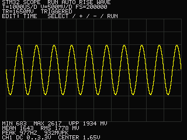
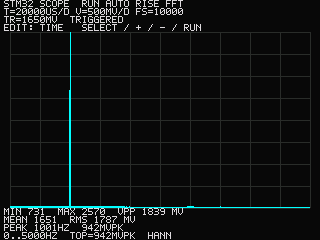

# STM32F407 Digital Oscilloscope

An Embedded C oscilloscope with timer-triggered ADC acquisition, DMA, a custom
ILI9341 SPI driver, FreeRTOS concurrency, and CMSIS-DSP frequency analysis.

**Status:** firmware implemented; host tests and ARM builds verified.
**Physical hardware validation is pending.** Sampling, display-rate, and accuracy
figures below are design targets until measured on the assembled board.

| Waveform view | FFT view |
|---|---|
|  |  |

These previews use synthetic samples through the actual processing and drawing
code. They are not photographs of hardware.

## Features

- One DC-coupled **0–3.3V** input, 12-bit ADC, up to **1MS/s** nominal sampling.
- TIM2-triggered ADC1 with DMA double buffering and explicit buffer ownership.
- 2,048-sample captures, 25% pre-trigger history, rising/falling hysteretic triggers.
- Auto, Normal, Single, and Run/Stop controls.
- 20µs/div–20ms/div time scales; 50mV/div–1V/div digital voltage scales.
- Minimum, maximum, peak-to-peak, mean, and RMS voltage measurements.
- 2,048-point CMSIS-DSP real FFT with DC removal, Hann window, spectrum, and peak frequency.
- RGB565 tile rendering that redraws changed regions and preserves short waveform peaks.
- Four statically allocated FreeRTOS tasks for acquisition, processing, input, and display.
- UART diagnostics, capture export, optional 1kHz DAC loopback, and automated checks.

Digital zoom does not change input limits. ADC sample rate is not analog bandwidth.
The input circuit's calculated response and aliasing limits are documented separately.

## Build and test

Required: CMake **3.25+**, Ninja, Python 3, Git, a native C compiler, and ARM GCC
with Newlib. On Ubuntu 24.04:

```sh
sudo apt-get install build-essential cmake ninja-build python3 git gcc-arm-none-eabi libnewlib-arm-none-eabi
```

From this repository:

```sh
python3 tools/bootstrap.py

cmake --preset host
cmake --build --preset host
ctest --preset host

cmake --preset debug
cmake --build --preset debug

cmake --preset release
cmake --build --preset release
```

Dependencies are pinned to immutable commits. Bootstrap needs network access
once; subsequent builds use local sources. Output images are
`build/debug/oscilloscope.{elf,bin,hex}` and the equivalent Release files.
A linker map and automatic memory-budget check accompany each build.
The default image leaves the optional DAC output disabled.

For sanitizer checks:

```sh
cmake --preset host-sanitize
cmake --build --preset host-sanitize
ctest --preset host-sanitize
```

## Assemble, flash, and operate

Start with the [parts list](hardware/bom.csv), [wiring table](hardware/wiring.md),
and [front-end schematic](hardware/schematic.svg). This project assumes an
STM32F407 development board; check its schematic before using the proposed pins.

Install OpenOCD and an ARM-capable GDB for ST-Link debugging. After connecting
the probe, power, and SWD signals:

```sh
python3 tools/flash.py build/debug/oscilloscope.elf
```

Follow the [bring-up guide](docs/bring-up.md) in order. Select cycles through
TIME, VOLTS, TRIGGER LEVEL, EDGE, MODE, and VIEW. +/− edit; Run/Stop holds or resumes.
Single mode holds after one triggered frame; Run rearms it.

## Project guide

| Topic | Document |
|---|---|
| Task priorities, memory, and ownership | [Architecture](docs/architecture.md) |
| Hardware limitations | [Analog design](hardware/analog-design.md) |
| ST-Link and VS Code | [Debugging](docs/debugging.md) |
| Voltage and clock calibration | [Calibration](docs/calibration.md) |
| DAC loopback and demonstration | [Demo](docs/demo.md) |
| Tests and 15-minute stress procedure | [Testing](docs/testing.md) |
| Raw sample export | [Capture export](docs/capture-export.md) |
| Verified checks and pending bench work | [Results](docs/results.md) |
| Versions and upstream licenses | [Dependencies](third_party/README.md) |

`firmware/` separates board support, drivers, acquisition, processing, display,
and application tasks. `tests/` runs hardware-independent code on the host.
`hardware/` contains assembly information; `tools/` contains local utilities.

## Commit history and publishing

The repository uses small, chronological commits under
**Fabian Hernandez <fabian.hernandezone@gmail.com>**. Inspect progress with:

```sh
git log --oneline --reverse
```

Suggested GitHub destination: `fabianhdz/stm32f407-oscilloscope`.
After creating an empty repository there, publish from this directory:

```sh
git remote add origin git@github.com:fabianhdz/stm32f407-oscilloscope.git
git push -u origin main
```

No remote has been created or pushed by this implementation. GitHub associates
commits with your account when the commit email is linked to that account.

## Inspiration and attribution

- [DLO-138-SPI report](https://ss1.xrea.com/harahore.g2.xrea.com/STM32/DLO-138-SPI.html)
- [ardyesp/DLO-138](https://github.com/ardyesp/DLO-138)
- [siliconvalley4066/DLO-138-SPI](https://github.com/siliconvalley4066/DLO-138-SPI)

Application and display code are written for this STM32F407 project; no DLO
source is copied. Project code is MIT licensed. ST, Arm, and FreeRTOS sources
retain their upstream notices, with license copies included in third_party/licenses/.

