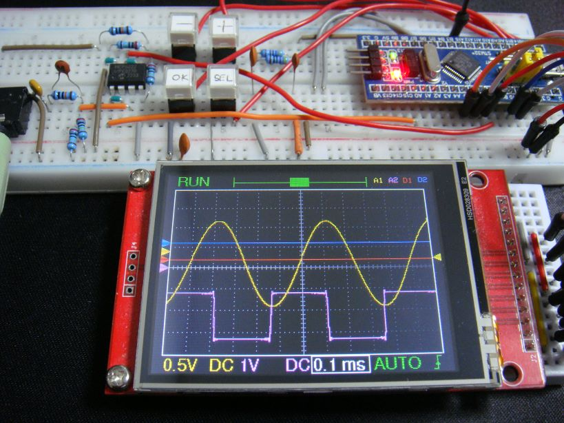
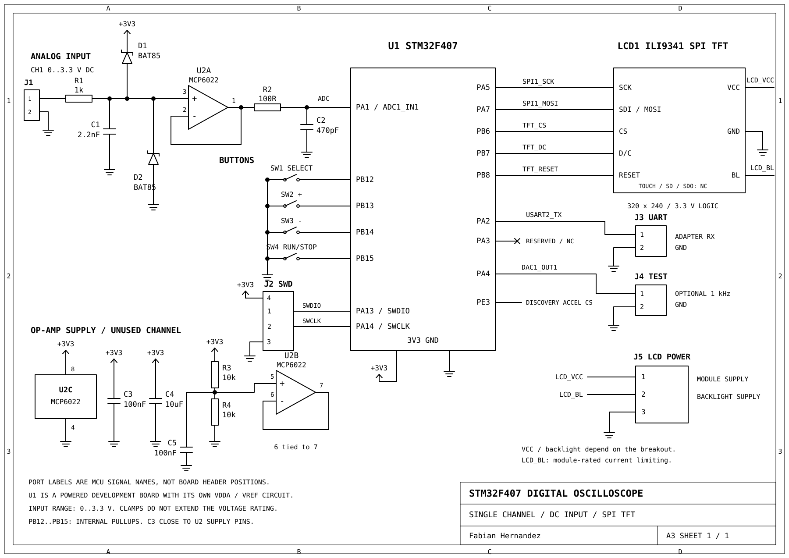

# STM32F407 Digital Oscilloscope

Single-channel oscilloscope firmware for the STM32F407, written in C with
FreeRTOS and CMSIS-DSP. An ILI9341 SPI display shows the waveform, voltage
measurements, and FFT spectrum.

Reference build: [DLO-138-SPI](https://ss1.xrea.com/harahore.g2.xrea.com/STM32/DLO-138-SPI.html).

- 12-bit ADC, configured from 10 kS/s to 1 MS/s.
- 2,048-sample captures with 25% pre-trigger history.
- Rising/falling triggers, Auto/Normal/Single modes, and Run/Stop.
- 20 µs/div–20 ms/div and 50 mV/div–1 V/div.
- Min, max, peak-to-peak, mean, RMS, and dominant frequency.

TIM2 triggers the ADC and DMA fills a rotating buffer pool. Separate tasks
handle capture, processing, input, and display. The renderer preserves narrow
peaks and sends only changed tiles over SPI.

The input is DC-coupled, 0–3.3 V, with an MCP6022 buffer. Four buttons adjust
settings. An optional DAC output provides a 1 kHz loopback signal.

- [Schematic](hardware/schematic.pdf) · [SVG](hardware/schematic.svg)
- [Parts list](hardware/bom.csv) and [wiring](hardware/wiring.md)
- [Build and debug](docs/build.md)
- [Firmware architecture](docs/architecture.md)

Builds use CMake/Ninja and ARM GCC. Host tests cover capture, buffer ownership,
signal processing, controls, and rendering. Dependencies and their licenses
are listed in [third_party](third_party/README.md).

