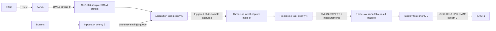

# Architecture

## Ownership and scheduling
DMA always owns exactly two raw buffers. On transfer complete, the ISR installs
a free replacement in the inactive address register before publishing the old
buffer. If no replacement exists, the completed buffer stays DMA-owned, the
block is dropped, and its sequence number still advances. Acquisition detects
the gap and clears trigger history. Metadata is serialized by short FreeRTOS
critical sections; large sample copies occur outside critical sections.

Capture/result mailboxes each have three payload slots and one READY index.
A writer only uses FREE slots; a reader holds READING ownership until release.
Publishing supersedes an unread READY slot. This is intentional display/DSP
frame skipping, distinct from losing raw ADC blocks. Tests exercise a held
reader over thousands of producer updates.

Acquisition scans every delivered sample. DSP runs at a bounded cadence
(40ms delay between jobs), processing the latest complete capture. The display
keeps its last immutable result while plotting and transfers only dirty tiles.
Button polling is periodic at 5ms with four stable polls before a press event.
All tasks, queues, DMA buffers, FFT storage, and frame slots are static.

## Time, interrupts, and memory
HSI 16MHz → PLL M=16, N=320, P=2 → 160MHz core. APB1 is 40MHz
(80MHz timer clock); APB2 is 80MHz. ADC runs at 20MHz, SPI1 at nominal
10MHz. HSI error is included through CAL_CLOCK_SCALE for sample-rate labels.
TIM2 supplies sample triggers. TIM5 supplies the HAL millisecond tick.
SysTick, PendSV, and SVC belong to FreeRTOS. TIM6/DMA1 stream 5 optionally drive DAC1.

NVIC uses four preemption bits. FreeRTOS's syscall ceiling is numeric priority 5.
ADC and its DMA IRQ use 6; TFT DMA uses 7; UART uses 10; TIM5 uses 15.
Only DMA/ADC handoff ISRs call FromISR APIs. ISR work excludes FFT, drawing, and
logging. Acquisition is task priority 5, processing 4, input 3, display 2.

DMA samples and task stacks reside in 128KB SRAM. The 24KB FFT workspace resides
in the separate 64KB CCM, initialized by spectrum_init/process, with no DMA
access. The linker reserves at least 4KB of unused SRAM for the main/ISR stack.
check_memory.py verifies loadable ELF regions and DMA placement after linking.
The DSP and portable core remain optimized in Debug to preserve sampling deadlines.

## Configuration and failures
Changes requiring acquisition restart increment a generation and overwrite the
one-entry settings queue. Acquisition stops the timer and ADC, waits for DMA to
disable, clears pending flags, resets ownership/history, then starts a fresh
capture. Processing/display reject obsolete generations. A stopped display
retains its last waveform. Single mode stops after a complete triggered frame.

DMA transfer faults, ADC overruns, and excessively delayed DMA interrupts stop
sampling and notify acquisition for restart. Counters retain evidence. Display
timeouts trigger a retry and full repaint without stopping acquisition.
Boot/RTOS faults latch scope_fault_reason for debugger inspection.
There is no USB stack, touch UI, SD storage, dynamic analog gain, or second channel.
