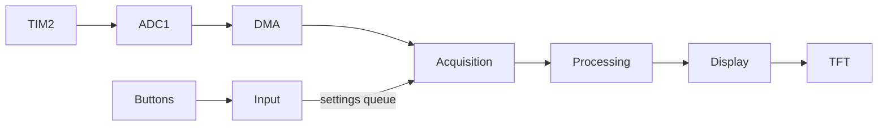

# Firmware architecture

| Task | Priority | Work |
|---|---:|---|
| Acquisition | 5 | Scan samples, detect triggers, assemble captures |
| Processing | 4 | Voltage measurements and CMSIS-DSP FFT |
| Input | 3 | Poll buttons every 5 ms and update settings |
| Display | 2 | Draw waveform/spectrum tiles and send UART diagnostics |

## Buffers

DMA owns two of six 1,024-sample buffers. The transfer-complete interrupt installs
a free replacement before handing a completed buffer to acquisition. If none
is available, the block is dropped and counted. A gap in sequence numbers
clears the capture history.

Completed captures contain 2,048 samples, including 512 before the trigger.
Capture and result mailboxes each have three slots. Readers retain ownership
until finished; new results can replace unread ones. This lets processing and
display skip old frames without blocking sampling.

Settings travel through a one-entry queue. Sample-rate and trigger changes
stop acquisition, clear the buffers, and start a new capture. Generation
numbers prevent older results from appearing after a restart.

## Timing and memory

The HSI-based PLL supplies a 160 MHz core clock. APB1 runs at 40 MHz with
80 MHz timer clocks; APB2 runs at 80 MHz. ADC1 runs at 20 MHz and SPI1 at 10 MHz.

TIM2 drives sampling, TIM5 supplies the HAL tick, and SysTick belongs to
FreeRTOS. The optional DAC source uses TIM6 and DMA1. IRQ priorities are
ADC/DMA 6, TFT DMA 7, UART 10, and HAL tick 15; the RTOS syscall ceiling is 5.

Tasks, queues, and sample buffers are static. DMA buffers reside in SRAM;
the FFT workspace uses CCM, which DMA cannot access. The linker reserves
4 KB for the interrupt stack. Newlib formatting has a separate 2 KB arena.

ADC overruns and DMA faults stop sampling and trigger a restart. Display
transfer failures reset SPI and repaint the screen. UART diagnostics retain
error counters; faults latch `scope_fault_reason` for the debugger.
